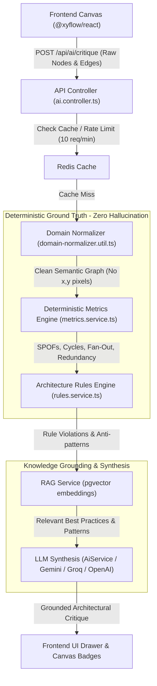

# Architecture Analysis & Critique Pipeline

> **Master Reference**: [`docs/architecture.md`](file:///d:/Major%20Project/System-Design-with-AI/docs/architecture.md) & [`docs/implementation-plan.md`](file:///d:/Major%20Project/System-Design-with-AI/docs/implementation-plan.md)  
> **Core Principle**: *Deterministic Before AI*. Never let an LLM count nodes, find circular dependencies, or guess Single Points of Failure (SPOFs). Graph algorithms calculate the truth; the AI synthesizes insights grounded on that truth.

---

## 1. High-Level Flow (End-to-End Pipeline)

When you drag and drop icons (Client, Gateway, Service, Database, Cache, Queue) on the canvas and click **"Run AI Critique"**, the system executes a 6-stage pipeline:



---

## 2. Step-by-Step Breakdown

### Step 1: Canvas to API (Frontend Extraction)
- **Source**: [`client/src/App.tsx`](file:///d:/Major%20Project/System-Design-with-AI/client/src/App.tsx)
- **What happens**:
  - The React Flow canvas contains visual nodes (`architectureNode`, `shapeNode`, `textNode`, etc.) with screen coordinates (`x: 420, y: 180`), CSS classes, and handles.
  - Non-architectural annotation shapes (like sticky notes, frames, freehand pencil drawings) are filtered out so they do not pollute system metrics.
  - The frontend sends a clean POST request to `/api/ai/critique`:
    ```json
    {
      "nodes": [...],
      "edges": [...],
      "systemContext": "High-throughput e-commerce checkout with 10k RPS target",
      "projectId": "proj-123"
    }
    ```

---

### Step 2: Domain Normalization (`DomainNormalizerUtil`)
- **Source**: [`server/src/domain/domain-normalizer.util.ts`](file:///d:/Major%20Project/System-Design-with-AI/server/src/domain/domain-normalizer.util.ts)
- **Why it exists**: **AI and Metrics Engines should NEVER see raw React Flow JSON**. Raw JSON has viewport coordinates, dragging state, and UI styling that confuses algorithms and wastes LLM token context.
- **Output**: A normalized `DomainGraph`:
  ```typescript
  export interface DomainGraph {
    nodes: DomainNode[];         // id, name, category, technology, replicas, isAsync
    edges: DomainEdge[];         // id, source, target, protocol, isAsync, bandwidth
    adjacencyList: Map<string, string[]>; // sourceId -> [targetIds]
    inDegrees: Map<string, number>;       // nodeId -> count of incoming edges
    outDegrees: Map<string, number>;      // nodeId -> count of outgoing edges
  }
  ```

---

### Step 3: Deterministic Metrics Engine (Graph Traversal & Math)
- **Source**: [`server/src/metrics/graph-traversal.util.ts`](file:///d:/Major%20Project/System-Design-with-AI/server/src/metrics/graph-traversal.util.ts)
- **Core Principle**: Pure mathematics and algorithmic graph traversal without invoking any AI.

#### 1. Component Category Tally
Traverses all nodes in the graph to tally:
- `services`: Microservices, APIs, background workers.
- `databases`: PostgreSQL, MongoDB, DynamoDB, etc.
- `caches`: Redis, Memcached.
- `queues`: Kafka, RabbitMQ, SQS, Redpanda.
- `loadBalancers`: Nginx, ALB, Envoy, API Gateway.

#### 2. SPOF (Single Point of Failure) Detection
A node is flagged as a Single Point of Failure (SPOF) if:
- **Service SPOF**: `category == 'service'` AND `replicas <= 1` AND `inDegree > 1` (multiple callers rely on a single non-replicated instance).
- **Database SPOF**: `category == 'database'` AND `replicas <= 1` AND `inDegree > 0` (only one primary DB instance without read replicas or failover).
- **Gateway SPOF**: `category == 'gateway'` AND `replicas <= 1` AND `inDegree > 0` (single point of ingress for all client traffic).

#### 3. Circular Dependency / Cycle Detection (DFS Algorithm)
- Uses **Depth-First Search (DFS)** with a recursion stack (`recStack`) to traverse the directed graph.
- If an outgoing edge points to a node that is currently in the active recursion stack, a cycle is detected (e.g. `OrderService -> PaymentService -> OrderService`).
- Circular dependencies cause deadlock risks, infinite HTTP loops, and cascading failures in production.

#### 4. Fan-Out Ratio
- Measures architectural coupling:
  $$\text{Fan-Out} = \frac{\sum \text{OutDegrees of compute services}}{\text{Total compute services}}$$
- If a service has a high fan-out ($\ge 4$ synchronous outgoing calls), it becomes a latency bottleneck and failure multiplier.

#### 5. Redundancy Score Formula ($0 - 100$)
Calculated deterministically:
$$\text{Score} = 100 - (20 \times \text{SPOF count}) - (15 \times \text{Cycle count}) - 10_{\text{no cache}} - 10_{\text{no queue}} + 5_{\text{has queue}} + 5_{\text{has cache}}$$
*(Clamped between $15$ and $100$)*.

---

### Step 4: Architecture Rules Engine
- **Source**: [`server/src/rules/rules.service.ts`](file:///d:/Major%20Project/System-Design-with-AI/server/src/rules/rules.service.ts)
- Evaluates industry anti-patterns in $<1\text{ms}$ through deterministic rule classes:

| Rule Class | Anti-Pattern Checked | Why it matters |
| :--- | :--- | :--- |
| **`SpofRule`** | Replicas $\le 1$ under traffic | Prevents total system outage when a single container/VM crashes. |
| **`UnprotectedDbRule`** | Client directly connected to Database | Massive security hole; exposes database credentials and schema to clients. |
| **`CacheTrafficRule`** | Database exists without Redis/Memcached | Heavy read traffic directly hammers disk I/O, spiking latency to $200\text{ms}+$. |
| **`AsyncMessagingRule`** | $\ge 3$ services with $0$ message queues | Synchronous HTTP chaining creates cascading timeouts under peak traffic. |
| **`DeepFanoutRule`** | Service calls $>4$ downstream dependencies synchronously | Creates high latency tail risk ($p99$ degradation). |

---

### Step 5: Semantic Knowledge Retrieval (RAG via `pgvector`)
- **Source**: [`server/src/rag/rag.service.ts`](file:///d:/Major%20Project/System-Design-with-AI/server/src/rag/rag.service.ts)
- **What happens**:
  - The detected metrics and rule violations are converted into semantic queries.
  - The system searches PostgreSQL using `pgvector` embeddings against a curated library of verified architectural patterns:
    - *Cache-Aside Pattern* (Look-aside caching with TTL)
    - *Read Replica & Connection Pooling* (PostgreSQL master-replica failover)
    - *Outbox & Event Sourcing with Kafka/Redpanda*
    - *Circuit Breaker & Fallback Patterns*
  - The top matching patterns are injected into the LLM prompt as ground-truth references.

---

### Step 6: Grounded LLM Synthesis & Zero-Crash Fallback
- **Source**: [`server/src/ai/ai.service.ts`](file:///d:/Major%20Project/System-Design-with-AI/server/src/ai/ai.service.ts)
- The system prompt enforces strict rules:
  1. **Do NOT recompute numbers**: Use the exact counts, SPOFs, and cycles supplied by the metrics engine.
  2. **Cite retrieved RAG patterns**: Back recommendations with industry architecture standards.
  3. **Return strict JSON format**:
     - `executiveSummary`: High-level evaluation.
     - `strengths`: What the design does well.
     - `spofRisks`: Specific components at risk of crashing the entire system.
     - `scalabilityBottlenecks`: Points where high traffic will choke.
     - `recommendations`: Concrete, actionable improvements.
- **Zero-Crash Graceful Degradation**:
  - If the external LLM times out ($>9\text{s}$) or encounters rate limits (429/500), the API automatically calls `buildDeterministicFallback()`.
  - It generates a full critique directly from the graph algorithms and rule violations so the user never sees a blank screen or a 500 error!

---

## 3. Concrete Walkthrough Example

### The Architecture Scenario:
Imagine you drop these components on the canvas:
1. `Web App` (Client)
2. `API Gateway` (Gateway, replicas: 1)
3. `User Service` (Service, replicas: 1)
4. `PostgreSQL` (Database, replicas: 1)
5. `Order Service` (Service, replicas: 1)

**Connections**:
- `Web App` $\to$ `API Gateway`
- `API Gateway` $\to$ `User Service`
- `API Gateway` $\to$ `Order Service`
- `User Service` $\to$ `PostgreSQL`
- `Order Service` $\to$ `PostgreSQL`

---

### What Happens in the Background:

#### 1. Metric Engine Output:
- `services`: 2 (`User Service`, `Order Service`)
- `databases`: 1 (`PostgreSQL`)
- `caches`: 0
- `queues`: 0
- `loadBalancers`: 1 (`API Gateway`)
- **SPOFs Found**:
  - `API Gateway` *(Single ingress gateway with no redundancy)*
  - `PostgreSQL` *(Unreplicated primary database handling multiple services)*
  - `User Service` & `Order Service` *(Single replicas)*
- **Fan-Out**: $1.0$
- **Redundancy Score**:
  $$100 - (20 \times 2) - 10_{\text{no cache}} = 50 / 100$$

#### 2. Rule Violations Detected:
1. `SPOF_DETECTED` (Severity: HIGH): Unreplicated single instance database `PostgreSQL` is a fatal single point of failure.
2. `CACHE_MISSING` (Severity: MEDIUM): Database `PostgreSQL` handles read traffic without an in-memory caching tier.

#### 3. RAG Best Practices Retrieved:
- *"Read Replica Pattern for Relational Databases"* (AWS RDS / Aurora architecture)
- *"Cache-Aside Strategy with Redis for Hot Queries"*

#### 4. Final Critique Rendered to You:
- **Executive Summary**: *"The architecture establishes a standard two-tier microservice layout with an API gateway. However, it suffers from severe single points of failure at the gateway and database layer, along with a lack of caching."*
- **SPOF Risks**:
  - *"PostgreSQL is a single point of failure; if it reboots or runs out of connections, both User Service and Order Service fail simultaneously."*
  - *"API Gateway has only 1 replica; any hardware crash drops 100% of user traffic."*
- **Bottlenecks**:
  - *"Both services write/read directly to PostgreSQL without a Redis cache, risking connection pool exhaustion under 10k RPS."*
- **Actionable Recommendations**:
  1. *Add a Redis cache in front of PostgreSQL to absorb $80\%$ of read traffic.*
  2. *Increase API Gateway replicas to $\ge 2$ with an external cloud load balancer.*
  3. *Configure PostgreSQL with at least 1 read replica and automated failover.*

---

## 4. Real-Time Streaming Updates

While analysis runs, the WebSocket gateway (`AnalysisGateway`) pushes live progress to the frontend UI drawer:
1. `TOPOLOGY`: Checking graph connectivity, redundancy & single points of failure.
2. `RULES`: Evaluating architectural constraint catalog & anti-patterns.
3. `RAG`: Retrieving verified industry patterns from vector store.
4. `SYNTHESIS`: Generating grounded expert critique.

This gives the developer immediate visual feedback at every milestone of the analysis.
