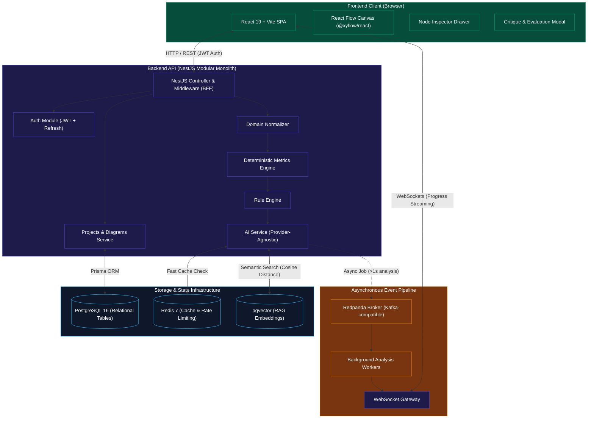
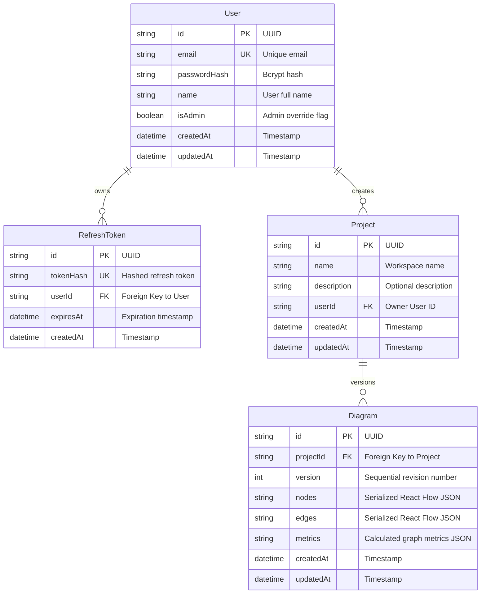
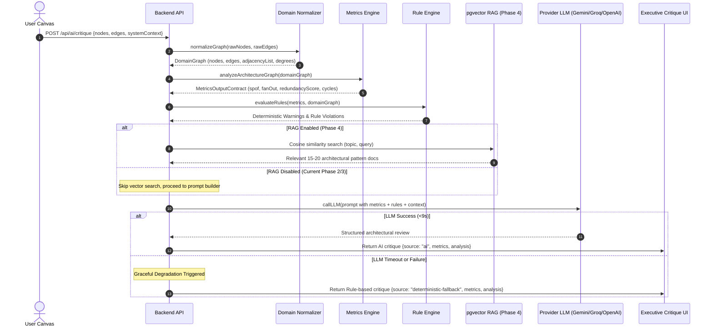
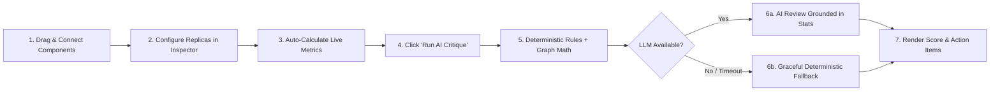
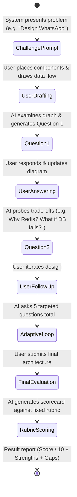
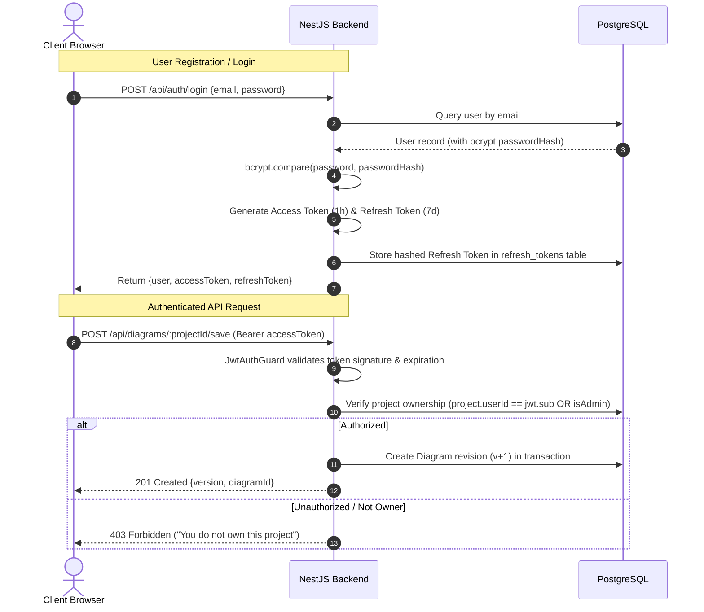
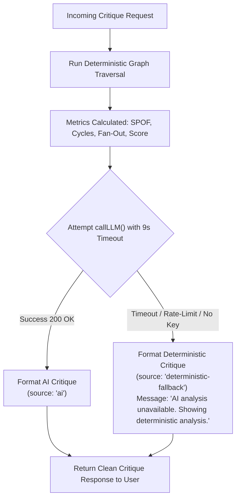

# System Design Interview Tool — System Architecture

> **Guiding Principle**: *Build the smallest system that demonstrates the architectural concept correctly. Whenever unsure whether to add or cut something, this is the tiebreaker.*

---

## 1. Project Overview & Goals

### 1.1 Mission
The **System Design Interview Tool** is a full-stack developer platform where software engineers visually diagram distributed system architectures and receive instant, AI-driven critique grounded in **deterministic graph checks**, **domain-specific RAG (Retrieval-Augmented Generation)**, and an interactive **Live Interview Mode**.

### 1.2 Core Architectural Axioms
1. **Deterministic Before AI**: Deterministic math and rule checks always execute *before* calling any LLM (`Metrics Engine → Rule Engine → RAG → LLM Reasoning`). This eliminates AI hallucinations, reduces token costs, and guarantees instant baseline feedback.
2. **Graceful Degradation as a Hard Spec**: If an LLM provider is unavailable, rate-limited, or times out ($>9\text{s}$), the system returns deterministic analysis results with zero downtime (`"AI analysis unavailable. Showing deterministic analysis."`).
3. **Decoupled Domain Abstraction**: The backend analysis engines never process raw UI coordinates or frontend-specific JSON. A dedicated normalizer converts canvas data into an abstract, UI-agnostic Domain Graph.
4. **Pragmatic Monolith Over Premature Microservices**: Built as a high-performance modular monolith (NestJS + React) using npm workspaces. Asynchronous heavy jobs (LLM analysis, simulation) are offloaded to Kafka-compatible message queues (Redpanda) and consumed by workers without breaking the monolithic code boundary.
5. **Measure, Don't Assume**: All performance metrics (latency, cache hit rate, queue throughput) must be benchmarked using real load tests (`k6` / `autocannon`), not estimated.

### 1.3 Non-Functional Requirements (NFRs)
| Requirement | Target Specification | Verification Method |
| :--- | :--- | :--- |
| **API Responsiveness** | CRUD endpoints remain responsive under normal load | Automated API benchmark |
| **Cached AI Latency** | $\le 200\text{ms}$ for cached evaluation queries | Redis response caching |
| **WebSocket Latency** | Near real-time streamed status updates ($<100\text{ms}$) | WebSocket connection profiling |
| **Data Integrity** | Zero data loss on save/update transactions | PostgreSQL ACID transactions |
| **Simulated Concurrency**| $\ge 100$ concurrent active simulated users | `k6` / `autocannon` load scripts |
| **Request Success Rate**| $\ge 95\%$ successful requests under peak load test | Continuous load monitoring |
| **Local Developer Setup**| One-command local spin-up | `docker compose up -d` |

---

## 2. High-Level Architecture

The platform follows a **Modular Monolith** pattern with a decoupled Single Page Application (SPA) frontend, an event-driven asynchronous job pipeline, and a unified storage layer combining relational data, cache, and vector embeddings.



### 2.1 Deliberately Excluded Components (YAGNI & Anti-Bloat)
To maintain velocity, eliminate premature complexity, and respect the project's guiding sentence, the following architectures are explicitly excluded:
* **Dedicated API Gateway Service**: Handled directly via NestJS route controllers, guards, and middleware (Backend-For-Frontend pattern).
* **Full Enterprise RBAC**: Uses strict resource ownership (`userId` owns `projectId`) plus a lightweight `isAdmin` boolean flag.
* **CRDT / Operational Transformation Collaborative Editing**: Single-user architecture drafting per project; real-time multi-cursor collaboration is permanently excluded.
* **Split Microservices**: All logical modules (`auth`, `diagrams`, `metrics`, `ai`) exist within a single NestJS process, communicating via internal TypeScript interfaces.
* **Kubernetes & Grafana**: Excluded from the core path. Local deployments run via Docker Compose; production runs on managed serverless/PaaS tiers.

---

## 3. Frontend, Backend & Database

### 3.1 Frontend Architecture (`client/`)
The frontend is an interactive Architecture Studio built with **React 19**, **TypeScript**, and **Vite**, styled with deep OLED developer ergonomics using **Tailwind CSS v4** and **shadcn/ui** design patterns.

* **Canvas Engine ([`@xyflow/react` v12](file:///d:/Major%20Project/System-Design-with-AI/client/src/App.tsx))**:
  * Infinite zoomable and pannable grid canvas.
  * Custom `ArchitectureNode` components featuring status rings, HA replica badges, and snapping connector handles.
  * Custom `CustomProtocolEdge` with animated traffic flow and protocol labels (`HTTPS`, `gRPC`, `SQL`, `Pub/Sub`, `WebSocket`, `TCP`).
* **Component Palette ([`ComponentPalette.tsx`](file:///d:/Major%20Project/System-Design-with-AI/client/src/components/palette/ComponentPalette.tsx))**:
  * 35+ real-world tech components organized by architectural category:
    * **Clients**: Web Browser, Mobile App, IoT Device.
    * **Gateways**: NGINX, Kong, AWS API Gateway, Cloudflare CDN.
    * **Services**: Node.js/NestJS, Go Service, Python Service, Docker Container.
    * **Databases**: PostgreSQL, MySQL, MongoDB, DynamoDB, Cassandra.
    * **Caches**: Redis, Memcached, Cloudflare Workers KV.
    * **Queues / Event Streaming**: Apache Kafka, RabbitMQ, AWS SQS, Redpanda.
* **Node Inspector Drawer ([`NodeConfigDrawer.tsx`](file:///d:/Major%20Project/System-Design-with-AI/client/src/components/inspector/NodeConfigDrawer.tsx))**:
  * Inspects selected node attributes: Name, Category, Technology, Replica count ($x1, x2, x3+$), Stateful flag, and custom notes.
  * Instant real-time SPOF elimination: increasing database replicas from 1 to 2 updates graph metrics immediately.
* **API Service Client ([`api.ts`](file:///d:/Major%20Project/System-Design-with-AI/client/src/services/api.ts))**:
  * Axios instance configured with JWT request interceptors, automatic bearer token injection, and structured API error handling.

### 3.2 Backend Architecture (`server/`)
Built with **NestJS 11** and **TypeScript**, enforcing strict modular boundaries, global dependency injection, and class-validator input validation.

* **Core Modules**:
  * [`AuthModule`](file:///d:/Major%20Project/System-Design-with-AI/server/src/auth/auth.module.ts): Email/password registration, bcryptjs hashing, JWT access token issuing ($1\text{h}$ expiration), and refresh token rotation ($7\text{d}$ expiration).
  * [`ProjectsModule`](file:///d:/Major%20Project/System-Design-with-AI/server/src/projects/projects.module.ts): CRUD operations for architecture workspaces with strict ownership checks.
  * [`DiagramsModule`](file:///d:/Major%20Project/System-Design-with-AI/server/src/diagrams/diagrams.module.ts): Versioned diagram persistence (`v1, v2, v3...`), rollbacks, and JSON serialization.
  * [`DomainModule`](file:///d:/Major%20Project/System-Design-with-AI/server/src/domain/domain.module.ts): Normalization utilities mapping UI shapes to normalized graphs.
  * [`MetricsModule`](file:///d:/Major%20Project/System-Design-with-AI/server/src/metrics/metrics.module.ts): Pure graph traversal and mathematical calculation engine.
  * [`AiModule`](file:///d:/Major%20Project/System-Design-with-AI/server/src/ai/ai.module.ts): Provider-agnostic LLM caller with structured prompt construction and deterministic fallback.
* **OpenAPI / Swagger**:
  * Auto-generated API documentation accessible at `/api/docs`.

### 3.3 Database & Schema (`server/prisma/schema.prisma`)
The primary database is **PostgreSQL 16** with the **`pgvector`** extension, accessed via **Prisma ORM**.



* **Versioned History Mechanism**: Rather than mutating diagrams in place, saving a diagram creates a new sequential `Diagram` record (`version = latest + 1`) within a database transaction, updating `project.updatedAt`.
* **RAG Knowledge Base Table (`TBD` - Phase 4)**:
  ```prisma
  // Planned for Phase 4
  model KnowledgeDoc {
    id        String                 @id @default(uuid())
    title     String
    topic     String                 // e.g. "sharding", "caching", "cap-theorem"
    content   String
    embedding Unsupported("vector(1536)")? // pgvector cosine embeddings
    createdAt DateTime               @default(now())
    @@map("knowledge_docs")
  }
  ```

---

## 4. AI/LLM, RAG & Agent Flow

### 4.1 Standardized AI Pipeline
The AI critique pipeline follows a strict unidirectional data flow where raw visual information is progressively transformed and enriched:



### 4.2 Domain Model Normalization Contract
The AI pipeline **never** sees raw React Flow coordinates, drag handles, or visual CSS classes. The [`DomainNormalizerUtil`](file:///d:/Major%20Project/System-Design-with-AI/server/src/domain/domain-normalizer.util.ts) converts the UI payload into clean TypeScript entities:

* **`DomainNode`**:
  ```typescript
  export interface DomainNode {
    id: string;
    name: string;
    category: 'client' | 'gateway' | 'service' | 'database' | 'cache' | 'queue';
    technology: string; // e.g. "postgresql", "redis", "kafka"
    replicas: number;   // e.g. 1, 2, 3
    isStateful: boolean;
  }
  ```
* **`DomainEdge`**:
  ```typescript
  export interface DomainEdge {
    id: string;
    sourceId: string;
    targetId: string;
    protocol: 'HTTPS' | 'gRPC' | 'SQL' | 'Pub/Sub' | 'WebSocket' | 'TCP';
    isAsync: boolean;
  }
  ```
* **`DomainGraph`**: Encapsulates nodes, edges, calculated in-degree maps, out-degree maps, and an adjacency list.

### 4.3 Metrics Engine Output Contract
Every downstream consumer (Rule Engine, RAG prompt constructor, Interview Mode scorer) depends upon the exact contract defined in [`domain-model.interface.ts`](file:///d:/Major%20Project/System-Design-with-AI/server/src/domain/domain-model.interface.ts#L26-L37):

```json
{
  "services": 4,
  "databases": 1,
  "caches": 1,
  "queues": 1,
  "spof": ["Primary PostgreSQL (Unreplicated primary database)"],
  "fanOut": 2.5,
  "redundancyScore": 75,
  "cycles": [],
  "warnings": [
    "High read latency risk: Database exists without an in-memory cache layer."
  ]
}
```

### 4.4 Deterministic Rule Engine Heuristics (Phase 3.5 & Current)
Before invoking any external AI model, deterministic graph algorithms check for structural anti-patterns:
1. **Single Point of Failure (SPOF)**:
   * Any database, gateway, or multi-consumer service where $\text{replicas} \le 1$.
2. **Circular Dependency Loops (DFS Cycle Detection)**:
   * Runs Depth-First Search with recursion stack tracking to detect circular deadlocks (e.g. `Service A -> Service B -> Service A`).
3. **Security Ingress Violation**:
   * Any direct connection from a `client` directly to a `database` without an intermediary `gateway` or `service` layer triggers a critical warning.
4. **Decoupling & Buffering Heuristics**:
   * If $\text{services} \ge 3$ and $\text{queues} == 0$, recommend asynchronous event streaming (Kafka/Redpanda).
   * If $\text{databases} > 0$ and $\text{caches} == 0$, flag high read latency risk.
5. **Redundancy Score Calculation**:
   $$\text{Score} = \max(15, \min(100, 100 - (\text{SPOF} \times 20) - (\text{Cycles} \times 15) - (\text{MissingCache} \times 10) - (\text{MissingQueue} \times 10) + (\text{Bonuses})))$$

### 4.5 Provider-Agnostic LLM Abstraction (`callLLM`)
The backend provides a single, unified method:
$$\text{callLLM}(\text{prompt: string}): \text{Promise}<\text{string} \mid \text{null}>$$
Configurable via `.env` without requiring code refactoring:
* **Default / Development**: Google Gemini 1.5 Flash (`GEMINI_API_KEY`) or Groq (`GROQ_API_KEY`, `llama-3.1-8b-instant`).
* **Local Fallback**: Ollama (`Llama 3.1 8B` or `Gemma 2 9B`).
* **Production Demo Polish**: OpenAI (`gpt-4o-mini` or GPT-4 class) / Anthropic Claude.

---

## 5. End-to-End User Journeys & Feature Flows

### 5.1 Diagramming, Evaluation & Critique Flow


### 5.2 Interactive Interview Mode Flow (Roadmap Phase 6)
In **Interview Mode**, the AI shifts from a passive static analyzer to an active, demanding System Design Interviewer:



#### Fixed Scoring Rubric (Phase 6 Specification)
To ensure objective, reproducible evaluations across multiple runs, scoring is weighted according to a predetermined rubric:
| Rubric Category | Weight | Evaluation Criteria |
| :--- | :---: | :--- |
| **Availability** | **25%** | Redundancy, failover strategies, no single points of failure |
| **Scalability** | **25%** | Horizontal partitioning, load balancing, caching, read/write splitting |
| **Reliability** | **20%** | Data replication, transaction guarantees, graceful failure recovery |
| **Performance** | **15%** | Latency minimization, network fan-out, queue buffering |
| **Security** | **10%** | Network boundary separation, client isolation, credential protection |
| **Cost Awareness** | **5%** | Practical infrastructure sizing without needless over-provisioning |

### 5.3 Simulation Engine Flow (Roadmap Phase 7 — Nice to Have)
Allows users to configure synthetic workloads and test architectural resilience:
* **Input Parameters**: Total active users ($N$), peak requests per second ($\text{req/s}$), cache hit ratio assumption ($\% \text{ hit}$), database replication lag.
* **Deterministic Math Simulation**: Predicts latency distributions, network bottleneck links, database saturation thresholds, and queue backlogs.
* **AI Plain-Language Translation**: Summarizes simulator output: *"At 25,000 req/s, your single PostgreSQL instance reaches 100% CPU saturation within 4 minutes. Adding an in-memory Redis cache with an estimated 80% hit rate reduces primary DB load to 5,000 req/s."*

---

## 6. APIs and Major Components

### 6.1 REST Endpoints

#### Authentication (`/api/auth`)
| Method | Endpoint | Description | Auth Required |
| :--- | :--- | :--- | :---: |
| `POST` | `/api/auth/register` | Register new user account; returns access & refresh tokens | No |
| `POST` | `/api/auth/login` | Authenticate credentials; returns access & refresh tokens | No |
| `POST` | `/api/auth/refresh` | Exchange valid refresh token for a new access token | No |
| `GET` | `/api/auth/me` | Fetch authenticated user profile and admin status | Yes (JWT) |

#### Projects & Workspaces (`/api/projects`)
| Method | Endpoint | Description | Auth Required |
| :--- | :--- | :--- | :---: |
| `GET` | `/api/projects` | List all projects owned by authenticated user | Yes (JWT) |
| `POST` | `/api/projects` | Create a new project workspace | Yes (JWT) |
| `GET` | `/api/projects/:id` | Fetch specific project details and diagram metadata | Yes (JWT) |

#### Diagram Versioning (`/api/diagrams`)
| Method | Endpoint | Description | Auth Required |
| :--- | :--- | :--- | :---: |
| `POST` | `/api/diagrams/:projectId/save` | Append new diagram version (`nodes`, `edges`, `metrics`) | Yes (JWT) |
| `GET` | `/api/diagrams/:projectId` | Fetch the latest diagram version for a project | Yes (JWT) |
| `GET` | `/api/diagrams/:projectId/history` | Fetch version history list (`version`, `createdAt`) | Yes (JWT) |
| `GET` | `/api/diagrams/:projectId/version/:v` | Rollback/inspect a specific historical diagram revision | Yes (JWT) |

#### Deterministic Metrics Engine (`/api/metrics`)
| Method | Endpoint | Description | Auth Required |
| :--- | :--- | :--- | :---: |
| `POST` | `/api/metrics/evaluate` | Calculate SPOFs, cycles, fan-out, and redundancy score | Optional |

#### AI Architecture Critique (`/api/ai`)
| Method | Endpoint | Description | Auth Required |
| :--- | :--- | :--- | :---: |
| `POST` | `/api/ai/critique` | Run deterministic graph checks + LLM critique with fallback | Optional |

### 6.2 Real-Time WebSocket Events (`TBD` — Roadmap Phase 3 & 5)
* **Namespace**: `/ws/analysis`
* **Client Emits**: `subscribe_analysis { projectId, diagramVersion }`
* **Server Streams**:
  * `status_update`: `{"step": "ANALYZING_TOPOLOGY", "message": "Checking redundancy..."}`
  * `status_update`: `{"step": "VECTOR_SEARCH", "message": "Retrieving architectural patterns..."}`
  * `critique_chunk`: Streaming LLM response tokens.
  * `critique_complete`: Final structured analysis payload.

### 6.3 Background Worker Jobs (`TBD` — Roadmap Phase 5)
* **Message Broker**: Redpanda (Kafka protocol on port `19092`).
* **Topics**:
  * `diagram.analysis.requested`: Triggers deep async LLM evaluation when queries exceed synchronous timeout boundaries.
  * `diagram.simulation.requested`: Triggers parameter-driven architectural load calculations.
* **Execution Rule**: If an operation takes $\ge 1\text{s}$ or does not require immediate synchronous UI blocking, it is queued to Redpanda.

---

## 7. Folder and File Structure

The project is structured as an npm workspaces monorepo:

```
system-design-with-ai/
├── package.json                   # Root workspaces config ("client", "server")
├── package-lock.json
├── docker/
│   └── docker-compose.yml         # PostgreSQL 16 (pgvector), Redis 7, Redpanda
├── docs/
│   ├── architecture.md            # System Architecture Specification
│   ├── implementation-plan.md     # Master Implementation Plan
│   ├── system-design-tool-roadmap.pdf # Master product roadmap
│   ├── adr/                       # Architecture Decision Records
│   │   └── ADR-001-monorepo-and-core-stack.md
│   └── stages/                    # Implementation walkthroughs & guides
│       ├── phase1.md              # Phase 1: Foundations & Architecture Whiteboard
│       └── phase2.md              # Phase 2: Core Product, Metrics & AI Critique
│
├── client/                        # Frontend Application (React 19 + Vite)
│   ├── index.html
│   ├── package.json
│   ├── vite.config.ts
│   └── src/
│       ├── main.tsx               # Client entry point
│       ├── App.tsx                # Master canvas view & state orchestration
│       ├── index.css              # Tailwind CSS v4 & theme variables
│       ├── components/
│       │   ├── auth/              # AuthModal, LoginForm, RegisterForm
│       │   ├── critique/          # CritiqueModal (AI & deterministic report UI)
│       │   ├── edges/             # CustomProtocolEdge (animated SVG flows)
│       │   ├── inspector/         # NodeConfigDrawer (node properties & replicas)
│       │   ├── navbar/            # TopNavbar (project picker, save, critique)
│       │   ├── nodes/             # ArchitectureNode (custom React Flow nodes)
│       │   ├── palette/           # ComponentPalette (35+ drag-and-drop components)
│       │   ├── sidebar/           # MetricsSidebar (live SPOF & stats panel)
│       │   └── toolbar/           # LeftToolRail (mode tools: select, hand, erase)
│       ├── data/
│       │   └── componentLibrary.ts# Tech catalog with categories & SVGs
│       ├── services/
│       │   └── api.ts             # Axios HTTP client with JWT interceptors
│       └── types/
│           └── index.ts           # Shared frontend TypeScript interfaces
│
└── server/                        # Backend Application (NestJS 11 + Prisma)
    ├── package.json
    ├── tsconfig.json
    ├── prisma/
    │   ├── schema.prisma          # User, RefreshToken, Project, Diagram schema
    │   └── migrations/            # SQL migration history
    └── src/
        ├── main.ts                # Bootstrap, Swagger, CORS, ValidationPipe
        ├── app.module.ts          # Root module registering all feature modules
        ├── auth/                  # Authentication module
        │   ├── auth.controller.ts
        │   ├── auth.service.ts    # Bcrypt hashing & token generation
        │   ├── jwt.strategy.ts    # Passport JWT bearer strategy
        │   └── jwt-auth.guard.ts  # Route authentication guard
        ├── projects/              # Projects workspace module
        │   ├── projects.controller.ts
        │   └── projects.service.ts# Project CRUD & ownership verification
        ├── diagrams/              # Diagram storage & versioning module
        │   ├── diagrams.controller.ts
        │   └── diagrams.service.ts# Version incrementing & history retrieval
        ├── domain/                # Decoupled domain graph models
        │   ├── domain-model.interface.ts # DomainNode, DomainEdge, DomainGraph
        │   └── domain-normalizer.util.ts # Strips UI coordinates to clean graph
        ├── metrics/               # Deterministic calculation engine
        │   ├── metrics.controller.ts
        │   ├── metrics.service.ts
        │   └── graph-traversal.util.ts   # DFS cycle, SPOF, fan-out algorithms
        ├── ai/                    # Provider-agnostic AI module
        │   ├── ai.controller.ts
        │   └── ai.service.ts      # Gemini / Groq / OpenAI with fallback
        └── prisma/                # Database connection lifecycle
            ├── prisma.module.ts
            └── prisma.service.ts
```

---

## 8. Authentication, Security & Data Protection



### 8.1 Key Security Controls
* **Password Security**: Salted hashing with `bcryptjs` (salt rounds = 10) before database persistence.
* **Token Architecture**:
  * **Short-lived Access Tokens**: JWT containing `sub` (userId), `email`, and `isAdmin`, signed with `JWT_SECRET` ($1\text{h}$ TTL).
  * **Refresh Token Rotation**: Hashed refresh tokens stored in the `refresh_tokens` database table ($7\text{d}$ TTL). A stolen refresh token can be revoked immediately by clearing the table record.
* **Resource Authorization**: Enforced at the service level. Every access to a project or diagram verifies that `project.userId === user.id`. The `isAdmin` boolean flag provides emergency administrative override without the overhead of complex RBAC trees.
* **Input Sanitization & Injection Defense**:
  * All incoming payloads validated via NestJS global `ValidationPipe({ whitelist: true, forbidNonWhitelisted: true, transform: true })` using `class-validator` DTOs.
  * SQL injection is impossible by design: Prisma ORM uses parameterized queries for all database interactions.
* **CORS Policy**: Strictly whitelist client origins (`CLIENT_URL` e.g., `http://localhost:5173`) with explicit credential support.
* **Zero Secrets in Code**: All API keys (`GEMINI_API_KEY`, `GROQ_API_KEY`, `JWT_SECRET`) are loaded strictly from environment variables via `@nestjs/config`.

---

## 9. Error Handling & Graceful Degradation

### 9.1 The Graceful Degradation Contract
Distributed system design tools cannot fail completely when third-party AI APIs experience outages or rate limits.



* **No Blank Screens**: An error from an external AI provider never surfaces as an HTTP 500 error to the client.
* **Transactional Save Safety**: When a diagram is saved, creating the new version and updating the project's `updatedAt` timestamp occur inside a `prisma.$transaction`. If either fails, the entire transaction rolls back cleanly.

---

## 10. Deployment and Scalability Architecture

### 10.1 Zero-Cost Free-Tier Production Stack
As specified in Section 5 of the roadmap, the application is intentionally designed to be deployable for **~$0** using generous free-tier cloud infrastructure:

| Infrastructure Layer | Technology Choice | Free Tier Provider | Purpose & Rationale |
| :--- | :--- | :--- | :--- |
| **Frontend Hosting** | React SPA | **Vercel** / **Netlify** | Zero-cost edge CDN hosting with continuous git deploys |
| **Backend Hosting** | NestJS Server | **Render** / **Railway** | Managed Node.js container hosting sufficient for demo workloads |
| **Relational Database** | PostgreSQL 16 | **Supabase** / **Neon** | Serverless PostgreSQL with generous free storage |
| **Vector Database** | `pgvector` | Same Postgres instance | Hosted directly inside Supabase/Neon via extension; no separate vector DB fee |
| **Cache & Rate Limit** | Redis 7 | **Upstash** | Serverless Redis with generous daily command limits |
| **Queue / Streaming** | Redpanda (Docker) | Self-hosted / Railway | Kafka-compatible event log with low memory footprint |
| **CI / CD Pipeline** | GitHub Actions | GitHub | Automated linting, type-checking, and test suite execution |

### 10.2 Scalability & Load Management
* **Stateless API Tier**: The NestJS application server maintains zero internal session state in memory. All session validity is derived from stateless JWTs or Redis, allowing horizontal replication of the backend container behind any standard load balancer.
* **Queue Decoupling (Roadmap Phase 5)**: Long-running AI evaluations and mathematical simulations are sent to Redpanda topics, preventing synchronous HTTP request workers from starving connection pools.
* **Benchmarking Target**: Load-tested using `k6` or `autocannon` to verify $\ge 100$ concurrent active users with a $\ge 95\%$ success rate and cached response latency $<200\text{ms}$.

---

## 11. Current vs Planned Roadmap Milestones

### 11.1 Milestone Status Matrix

| Version | Phase | Scope & Deliverables | Status | Implementation Details |
| :---: | :--- | :--- | :---: | :--- |
| **v0.1** | **Phase 1: Foundations** | React Flow canvas, Tailwind v4 dark mode, JWT auth + refresh tokens, PostgreSQL schema, Docker skeleton, Swagger | **Completed** | Full auth lifecycle, canvas with 35+ tech components, Docker compose |
| **v0.2** | **Phase 2: Core Product (Canvas)**| Node config drawer, component duplication/deletion, edge protocol labeling, diagram versioning | **Completed** | Slide-over inspector drawer, custom animated protocol edges |
| **v0.3** | **Phase 2: Core Product (Metrics)**| Domain normalizer, deterministic graph traversal, SPOF detection, DFS cycle detection, fan-out, redundancy score | **Completed** | Exact roadmap metrics contract implemented in `graph-traversal.util.ts` |
| **v0.4** | **Phase 2: Core Product (AI v1)** | Provider-agnostic AI service (`callLLM`), structured prompt builder, deterministic graceful fallback, critique modal | **Completed** | Supports Gemini, Groq, OpenAI with zero-downtime fallback |
| **v0.5** | **Phase 3: Performance Layer** | Redis response caching, API rate limiting, WebSocket streamed progress updates, 15-20 architectural KB docs | `Planned` | Redis caching & WebSocket streaming gateway |
| **v0.5b**| **Phase 3.5: Rule Engine** | Standalone deterministic rule engine executing prior to LLM/RAG | **Partially Done** | Core graph rules embedded in Stage 3; standalone rule engine pipeline expansion `TBD` |
| **v0.6** | **Phase 4: RAG Pipeline** | `pgvector` knowledge base embeddings, cosine similarity search, LLM tool calling for live diagram metrics | `Planned` | Embedding 15-20 system design pattern docs into PostgreSQL |
| **v0.7** | **Phase 5: Async Architecture** | Redpanda job queues for AI & simulation, background consumer workers, WebSocket push, k6 load testing | `Planned` | Decoupling analysis jobs from HTTP request/response loop |
| **v0.8** | **Phase 6: Interview Mode** | Interactive 5-question interview loop, adaptive follow-ups, fixed 6-category rubric scoring (1-10) | `Planned` | Interactive interviewer agent dialog |
| **v0.9** | **Phase 7: Simulation Engine** | Parameterized traffic load simulator (req/s, cache hit %, DB saturation), AI plain-language explanation | `Nice-to-Have` | Optional feature if schedule permits |
| **v1.0** | **Phase 8: Production Polish** | Cloud deployment (Vercel + Render + Neon), performance benchmark verification, demo recording | `Planned` | Live URL and verified resume metrics |

### 11.2 MVP Scope Boundaries
* **MVP (Must Have)**:
  * Authentication & Resource Ownership
  * Drag-and-drop Diagram Canvas & Tech Palette
  * Versioned Save/Load Project Storage
  * Deterministic Metrics Engine (SPOF, cycles, fan-out)
  * Deterministic Rule Engine & Baseline Feedback
  * Provider-Agnostic AI Critique with Graceful Degradation
  * RAG Pipeline via `pgvector`
  * Redpanda Async Processing for Heavy Analysis
  * Interactive Interview Mode with Fixed Rubric
  * Production Cloud Deployment
* **Nice to Have (Conditional on Timeline)**:
  * Simulation Engine
  * PDF/Image Architecture Report Export
  * Visual Performance Metrics Dashboard
  * Kubernetes Manifests
* **Permanently Excluded**:
  * Multi-user CRDT Real-time Editing
  * Advanced Enterprise RBAC / Permissions Hierarchy
  * Multi-Tenant Organization Management

---

## 12. Verification Against Roadmap Requirements

| Roadmap Section | Requirement in Roadmap | Addressed in `architecture.md` | Section Reference |
| :--- | :--- | :---: | :--- |
| **Sec 1: Guiding Sentence** | Build the smallest system demonstrating concept | Yes | Header & Section 1.1 |
| **Sec 2: NFRs** | 100 simulated users, <200ms cached AI, 0 data loss | Yes | Section 1.3 & Section 10.2 |
| **Sec 3: Principles** | Deterministic before AI; Graceful degradation | Yes | Section 1.2 & Section 4.1 |
| **Sec 4: Final Architecture** | Modular monolith diagram, excluded components | Yes | Section 2 & Section 2.1 |
| **Sec 4: Standardized AI Pipeline**| Domain Model -> Metrics -> Rules -> RAG -> LLM -> WS | Yes | Section 4.1 Sequence Diagram |
| **Sec 4: Metrics Output Contract**| Exact JSON contract (services, DBs, spof, fanOut, etc.) | Yes | Section 4.3 |
| **Sec 4: Frozen Tech Stack** | React, NestJS, Postgres, pgvector, Redis, Redpanda | Yes | Section 3 & Section 10.1 |
| **Sec 4: Four Logical Modules**| Editor, Analysis, AI, Interview boundaries | Yes | Section 3.1, 3.2, 4.1, 5.2 |
| **Sec 5: Free Stack (~$0)** | Vercel, Render/Railway, Supabase/Neon, Upstash | Yes | Section 10.1 Table |
| **Sec 6: Phase Plan (1-8)** | Full breakdown from v0.1 Foundations to v1.0 Release | Yes | Section 11.1 Matrix |
| **Sec 6: Phase 6 Interview Mode**| 5 questions, fixed scoring rubric with exact weights | Yes | Section 5.2 & Rubric Table |
| **Sec 6: Phase 7 Simulation** | Traffic load params, bottleneck simulator | Yes | Section 5.3 |
| **Sec 7: MVP Boundaries** | Must-have vs nice-to-have vs excluded | Yes | Section 11.2 |
| **Sec 8: ADRs** | Architecture Decision Record structure | Yes | Section 7 & `docs/adr/` |
| **Sec 9: Testing Strategy** | Unit tests (metrics/rules), integration, e2e | Yes | Section 1.3 & Section 10.2 |
| **Sec 10: Security** | Bcrypt, JWT rotation, input validation, CORS, ORM | Yes | Section 8 & Section 8.1 |
