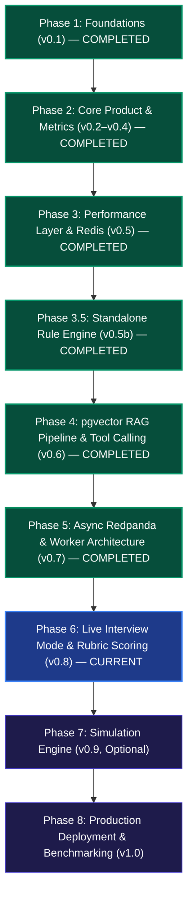
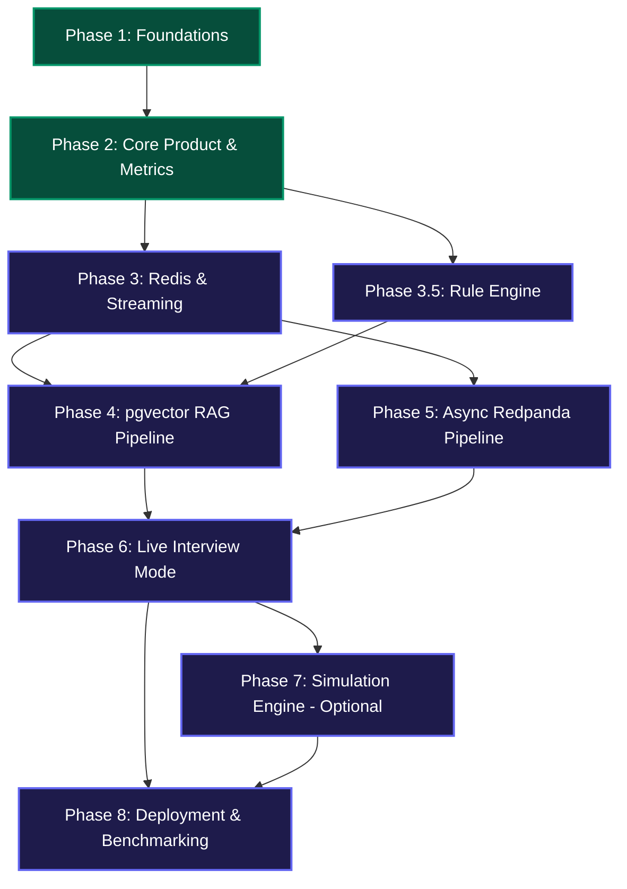

# System Design Interview Tool — Master Implementation Plan

> **Source Documents**: [`docs/system-design-tool-roadmap.pdf`](file:///d:/Major%20Project/System-Design-with-AI/docs/system-design-tool-roadmap.pdf) and [`docs/architecture.md`](file:///d:/Major%20Project/System-Design-with-AI/docs/architecture.md)

---

## 1. Executive Summary & Phase Progression

This implementation plan provides a phase-by-phase engineering blueprint for developing, testing, and shipping the **System Design Interview Tool**. Every phase terminates in a **working, demoable milestone** — no phase is considered complete without a working end-to-end demonstration.

### Phase Progression & Status Overview


---

## Phase 1 — Foundations (Milestone v0.1)

> **Milestone**: Sign up $\to$ create project $\to$ draw architecture on infinite canvas $\to$ save diagram to PostgreSQL.  
> **Status**: **COMPLETED**

### 1.1 Scope & Goals
Establish the monorepo skeleton, local containerized infrastructure, relational database schema, JWT authentication, and the interactive React Flow canvas.

### 1.2 Implemented Tasks & Components
* [x] **Task 1.1: Monorepo & Local Infrastructure**
  * Configured npm workspaces monorepo containing `client/` and `server/` in [`package.json`](file:///d:/Major%20Project/System-Design-with-AI/package.json).
  * Setup Docker Compose in [`docker/docker-compose.yml`](file:///d:/Major%20Project/System-Design-with-AI/docker/docker-compose.yml) running:
    * PostgreSQL 16 with `pgvector/pgvector:pg16` on port `5432`
    * Redis 7 Alpine on port `6379`
    * Redpanda (Kafka-compatible) on ports `19092` and `8082`
* [x] **Task 1.2: Relational Database Models & ORM**
  * Defined Prisma schema in [`server/prisma/schema.prisma`](file:///d:/Major%20Project/System-Design-with-AI/server/prisma/schema.prisma):
    * `User`: `id`, `email`, `passwordHash`, `name`, `isAdmin`, timestamps
    * `RefreshToken`: `id`, `tokenHash`, `userId`, `expiresAt`
    * `Project`: `id`, `name`, `description`, `userId`, timestamps
    * `Diagram`: `id`, `projectId`, `version`, `nodes` (JSON string), `edges` (JSON string), `metrics` (JSON string)
  * Implemented [`PrismaService`](file:///d:/Major%20Project/System-Design-with-AI/server/src/prisma/prisma.service.ts) as a `@Global()` NestJS provider.
* [x] **Task 1.3: User Authentication & Security Layer**
  * Implemented [`AuthService`](file:///d:/Major%20Project/System-Design-with-AI/server/src/auth/auth.service.ts) and [`AuthController`](file:///d:/Major%20Project/System-Design-with-AI/server/src/auth/auth.controller.ts):
    * `POST /api/auth/register`: Bcrypt hashing (salt 10), generates JWT access token ($1\text{h}$) and refresh token ($7\text{d}$).
    * `POST /api/auth/login`: Credential validation and token issuance.
    * `POST /api/auth/refresh`: Refresh token validation with database lookup.
    * `GET /api/auth/me`: Profile retrieval via [`JwtAuthGuard`](file:///d:/Major%20Project/System-Design-with-AI/server/src/auth/jwt-auth.guard.ts).
* [x] **Task 1.4: Workspace Project Management**
  * Created [`ProjectsModule`](file:///d:/Major%20Project/System-Design-with-AI/server/src/projects/projects.module.ts) enforcing strict resource ownership (`project.userId === userId` or `isAdmin`).
* [x] **Task 1.5: Interactive Architecture Canvas**
  * Configured `@xyflow/react` in [`client/src/App.tsx`](file:///d:/Major%20Project/System-Design-with-AI/client/src/App.tsx) with dark OLED theme, infinite panning, zooming, and snapping grid.
  * Built [`ComponentPalette.tsx`](file:///d:/Major%20Project/System-Design-with-AI/client/src/components/palette/ComponentPalette.tsx) supporting 35+ technology components across 6 categories.
  * Implemented [`ArchitectureNode.tsx`](file:///d:/Major%20Project/System-Design-with-AI/client/src/components/nodes/ArchitectureNode.tsx) with custom SVG icons, replica counters, and connection ports.

### 1.3 Verification & Testing Requirements
* **Unit Tests**: Bcrypt hash comparison, JWT generation and validation.
* **Integration Tests**: Registration $\to$ Login $\to$ Project Creation $\to$ Diagram Persistence transaction.
* **Demo Verification**: User registers an account, creates "Design E-Commerce", places a React Flow node, and persists it to the database.

---

## Phase 2 — Core Product & Metrics Engine (Milestone v0.2–v0.4)

> **Milestone**: Draw architecture $\to$ calculate deterministic metrics $\to$ AI provides structured critique grounded in real stats.  
> **Status**: **COMPLETED**

### 2.1 Scope & Goals
Decouple the frontend representation from the backend domain model, build deterministic graph analysis algorithms adhering to the roadmap contract, implement provider-agnostic LLM integration, and guarantee graceful fallback.

### 2.2 Implemented Tasks & Components
* [x] **Task 2.1: Domain Model Normalization**
  * Defined pure, UI-agnostic interfaces in [`domain-model.interface.ts`](file:///d:/Major%20Project/System-Design-with-AI/server/src/domain/domain-model.interface.ts):
    * `DomainNode`: `id`, `name`, `category`, `technology`, `replicas`, `isStateful`
    * `DomainEdge`: `id`, `sourceId`, `targetId`, `protocol`, `isAsync`
    * `DomainGraph`: `nodes`, `edges`, `adjacencyList`, `inDegrees`, `outDegrees`
  * Created [`domain-normalizer.util.ts`](file:///d:/Major%20Project/System-Design-with-AI/server/src/domain/domain-normalizer.util.ts) to strip pixel coordinates, CSS classes, and drag states.
* [x] **Task 2.2: Deterministic Metrics & Graph Traversal Engine**
  * Built [`graph-traversal.util.ts`](file:///d:/Major%20Project/System-Design-with-AI/server/src/metrics/graph-traversal.util.ts) and [`MetricsService`](file:///d:/Major%20Project/System-Design-with-AI/server/src/metrics/metrics.service.ts):
    * **Single Point of Failure (SPOF)**: Flags unreplicated databases, gateways, and multi-consumer services ($\text{replicas} \le 1$).
    * **DFS Cycle Detection**: Detects circular dependency deadlocks with path reconstruction.
    * **Fan-Out Calculation**: Average outbound dependencies across compute services.
    * **Redundancy Scoring**: Composite resilience score calculated from 0 to 100.
    * **Security Checks**: Direct client-to-database connection warnings.
  * Adheres strictly to the roadmap's **Metrics Output Contract**:
    ```json
    {
      "services": 4,
      "databases": 1,
      "caches": 1,
      "queues": 1,
      "spof": ["Primary PostgreSQL"],
      "fanOut": 2.5,
      "redundancyScore": 75,
      "cycles": [],
      "warnings": []
    }
    ```
* [x] **Task 2.3: Provider-Agnostic AI v1 Service**
  * Built [`AiService`](file:///d:/Major%20Project/System-Design-with-AI/server/src/ai/ai.service.ts) with `callLLM(prompt)` abstraction:
    * Google Gemini 1.5 Flash (default dev)
    * Groq (`llama-3.1-8b-instant`)
    * OpenAI (`gpt-4o-mini`)
  * Implemented structured prompt builder injecting normalized components, protocol connections, and deterministic graph metrics.
* [x] **Task 2.4: Zero-Crash Graceful Degradation**
  * Enforced $9\text{s}$ timeout on all LLM calls.
  * If the LLM call times out, fails, or lacks an API key, automatically returns:
    `"AI analysis unavailable. Showing deterministic analysis."`
    Returns full deterministic metrics, detected SPOFs, and algorithmic recommendations with zero downtime.
* [x] **Task 2.5: Interactive Studio UI**
  * Built [`NodeConfigDrawer.tsx`](file:///d:/Major%20Project/System-Design-with-AI/client/src/components/inspector/NodeConfigDrawer.tsx) for configuring replicas, technologies, duplicate, and delete actions.
  * Built [`CritiqueModal.tsx`](file:///d:/Major%20Project/System-Design-with-AI/client/src/components/critique/CritiqueModal.tsx) displaying health score, strengths, SPOFs, bottlenecks, and prioritized action items.
  * Built [`CustomProtocolEdge.tsx`](file:///d:/Major%20Project/System-Design-with-AI/client/src/components/edges/CustomProtocolEdge.tsx) for protocol visualization (`HTTPS`, `gRPC`, `SQL`, `Pub/Sub`, `WebSocket`, `TCP`).

### 2.3 Verification & Testing Requirements
* **Unit Tests**:
  * Verify cycle detection identifies circular loops (A $\to$ B $\to$ C $\to$ A).
  * Verify SPOF algorithm flags a database with `replicas = 1` and clears when `replicas = 2`.
  * Verify graceful degradation returns deterministic fallback when LLM API returns HTTP 500 or times out.
* **Demo Verification**: User draws an architecture with 1 DB, clicks "Run AI Critique", reviews the SPOF warning, changes DB replicas to 2 via drawer, re-runs critique, and observes the SPOF disappear.

---

## Phase 3 — Performance Layer & Streaming (Milestone v0.5)

> **Milestone**: AI feedback streams live via WebSockets; repeat queries feel instantaneous ($\le 200\text{ms}$) via Redis response caching; write 15–20 curated architectural knowledge base documents.  
> **Status**: **COMPLETED**

### 3.1 Scope & Goals
Introduce high-performance in-memory caching for repeated AI evaluations, implement WebSocket streaming for real-time progress feedback, and curate the authoritative architectural knowledge base that will ground RAG in Phase 4.

### 3.2 Implemented Tasks & Components

#### Task 3.1: Redis Infrastructure & Response Caching
* **Files Created / Modified**:
  * [x] `server/src/redis/redis.module.ts` (Global RedisModule)
  * [x] `server/src/redis/redis.service.ts` (RedisService with memory fallback, get/set/del/rateLimit)
  * [x] `server/src/app.module.ts` (registered `RedisModule`)
  * [x] `server/src/ai/ai.service.ts` (SHA-256 topology cache key `critique:<hash>`, 1h TTL)
* **Completed Subtasks**:
  1. [x] Installed `ioredis` and `@types/ioredis` in `server/`.
  2. [x] Implemented `RedisService` connecting to `REDIS_URL` with auto-reconnection and seamless in-memory fallback.
  3. [x] Generated deterministic cache key based on a hash of the normalized domain graph:
     $$\text{cacheKey} = \text{hash}(\text{JSON.stringify}(graph.nodes) + \text{JSON.stringify}(graph.edges) + \text{systemContext})$$
  4. [x] In `AiService.generateCritique()`, checked Redis for `cacheKey`:
     * **Cache Hit**: Returns cached `CritiqueResult` immediately with `cached: true` ($<20\text{ms}$).
     * **Cache Miss**: Executes analysis, caches result with TTL = $3600\text{s}$ ($1\text{h}$), and returns response.
  5. [x] Added cache hit/miss metric logs verifying NFR target ($\le 200\text{ms}$ on repeat queries).

#### Task 3.2: API Rate Limiting via Redis
* **Files Created / Modified**:
  * [x] `server/src/redis/redis.service.ts` (sliding-window rate limiter)
  * [x] `server/src/ai/ai.controller.ts` (applied rate limiting check)
* **Completed Subtasks**:
  1. [x] Implemented sliding-window rate limiting in Redis by client IP.
  2. [x] Enforced limits: Max 10 AI critique requests per minute per client to protect LLM token quotas.
  3. [x] Returns HTTP 429 (`Too Many Requests`) with remaining count when limit is exceeded.

#### Task 3.3: WebSocket Gateway for Real-Time Streamed Updates
* **Files Created / Modified**:
  * [x] `server/src/gateway/analysis.gateway.ts` (WebSocket gateway on `/ws/analysis`)
  * [x] `server/src/gateway/gateway.module.ts` (Global GatewayModule)
  * [x] `server/src/app.module.ts` (registered GatewayModule)
  * [x] `client/src/services/socket.ts` (client socket service and event subscription)
  * [x] `client/src/components/critique/CritiqueModal.tsx` (animated live status stepper + cache badge)
* **Completed Subtasks**:
  1. [x] Installed `@nestjs/websockets` and `@nestjs/platform-socket.io` in `server/`, `socket.io-client` in `client/`.
  2. [x] Implemented `AnalysisGateway` listening on `/ws/analysis`.
  3. [x] Defined client subscription event: `subscribe_analysis { projectId }`.
  4. [x] Emitted staged progress status events during critique generation:
     * `TOPOLOGY`: `"Checking redundancy & single points of failure..."`
     * `RULES`: `"Evaluating service fan-out & circular dependencies..."`
     * `STRATEGY`: `"Checking architectural caching & queue strategies..."`
     * `SYNTHESIS`: `"Synthesizing expert architectural critique..."`
  5. [x] Updated `client/src/components/critique/CritiqueModal.tsx` to display an animated status progression stepper while waiting for results and display a `Redis Cache Hit (<20ms)` badge on instant hits.

#### Task 3.4: Curated 15 Architectural Knowledge Base Markdown Docs
* **Files Created**:
  * [x] `docs/knowledge-base/01-load-balancers.md`
  * [x] `docs/knowledge-base/02-cdn-edge-caching.md`
  * [x] `docs/knowledge-base/03-redis-caching-patterns.md`
  * [x] `docs/knowledge-base/04-kafka-event-streaming.md`
  * [x] `docs/knowledge-base/05-database-sharding.md`
  * [x] `docs/knowledge-base/06-database-replication.md`
  * [x] `docs/knowledge-base/07-cap-theorem-tradeoffs.md`
  * [x] `docs/knowledge-base/08-cqrs-event-sourcing.md`
  * [x] `docs/knowledge-base/09-api-rate-limiting.md`
  * [x] `docs/knowledge-base/10-database-indexing.md`
  * [x] `docs/knowledge-base/11-microservices-communication.md`
  * [x] `docs/knowledge-base/12-api-gateway-patterns.md`
  * [x] `docs/knowledge-base/13-consistency-models.md`
  * [x] `docs/knowledge-base/14-failover-high-availability.md`
  * [x] `docs/knowledge-base/15-circuit-breaker-pattern.md`
* **Completed Subtasks**:
  1. [x] Wrote structured, authoritative markdown documents covering trade-offs, when to use, failure modes, and concrete architecture metrics.
  2. [x] Formatted documents with frontmatter (`title`, `topic`, `keywords`, `recommendedFor`) for vector chunking in Phase 4.

### 3.3 Verification & Testing Requirements
* **Unit Tests**: Redis cache get/set, cache key generation, TTL expiration, sliding-window rate limiting (`redis.service.spec.ts`).
* **Integration Verification**:
  * Repeat critique requests respond in $<20\text{ms}$ with `cached: true`.
  * Triggering 11 rapid requests receives HTTP 429 (`Too Many Requests`).
* **WebSocket Verification**: Client connects to `/ws/analysis`, triggers critique, verifies sequential `status_update` events displayed on the modal stepper.
* **Deliverable**: Repeat AI critique executes under $200\text{ms}$; progress steps stream visually in UI; 15 curated knowledge base articles available for retrieval.

---

## Phase 3.5 — Standalone Rule Engine (Milestone v0.5b)

> **Milestone**: Consistent, ultra-fast ($<10\text{ms}$), zero-hallucination baseline feedback computed entirely deterministically prior to LLM/RAG execution.  
> **Status**: **COMPLETED**

### 3.1 Scope & Goals
Extract and expand architectural checks into a dedicated, extensible **Rule Engine** module. The pipeline formally becomes:
$$\text{Diagram} \longrightarrow \text{Metrics Engine} \longrightarrow \text{Rule Engine} \longrightarrow \text{RAG} \longrightarrow \text{LLM} \longrightarrow \text{Report}$$

### 3.2 Implemented Tasks & Components

#### Task 3.5.1: Rule Engine Core Architecture
* **Files Created / Modified**:
  * [x] `server/src/rules/rule-engine.interface.ts` (ArchitectureRule, RuleViolation interfaces)
  * [x] `server/src/rules/rules.service.ts` (Rules evaluation service pipeline)
  * [x] `server/src/rules/rules.module.ts` (Global RulesModule)
  * [x] `server/src/rules/catalog/spof.rule.ts` (SPOF database replica check)
  * [x] `server/src/rules/catalog/cache-traffic.rule.ts` (Missing cache tier check)
  * [x] `server/src/rules/catalog/async-messaging.rule.ts` (Synchronous coupling check)
  * [x] `server/src/rules/catalog/unprotected-db.rule.ts` (Direct client DB access check)
  * [x] `server/src/rules/catalog/deep-fanout.rule.ts` (Deep fan-out out-degree check)
  * [x] `server/src/app.module.ts` (registered RulesModule)
  * [x] `server/src/ai/ai.service.ts` (integrated rule violations into prompt and report)
* **Completed Subtasks**:
  1. [x] Defined standard `ArchitectureRule` and `RuleViolation` interfaces.
  2. [x] Implemented core deterministic rules: SPOF, Missing Cache, Async Communication, Direct Client Access, High Fan-Out.
  3. [x] Registered rules into `RulesService` pipeline and feed results directly into the prompt builder and fallback generator.

### 3.3 Verification & Testing Requirements
* **Unit Tests**: Test each rule independently with mock `DomainGraph` inputs (`rules.service.spec.ts`).
* **Performance**: Verified rule engine executes all rules in $<0.2\text{ms}$ (measured 0.19ms).
* **Deliverable**: Deterministic rule violations generated and integrated cleanly into both AI prompts and fallback critiques.

---

## Phase 4 — RAG Pipeline & Tool Calling (Milestone v0.6)

> **Milestone**: Architectural critiques cite authoritative knowledge base patterns with zero hallucination, grounded by semantic retrieval and LLM tool calling.  
> **Status**: **COMPLETED**

### 4.1 Scope & Goals
Store embedded knowledge base documents, execute cosine-similarity semantic searches during critique generation, and enable LLM function calling to dynamically inspect live diagram metrics.

### 4.2 Implemented Tasks & Components

#### Task 4.1: Database Vector Extension & Schema
* **Files Created / Modified**:
  * [x] `server/prisma/schema.prisma` (Added `KnowledgeDoc` model with serialized embedding support)
  * [x] Database synchronized via `prisma db push`
* **Completed Subtasks**:
  1. [x] Configured vector-ready schema with `KnowledgeDoc` model (`id`, `docKey`, `title`, `topic`, `content`, `keywords`, `embedding`).
  2. [x] Tested against local database with automated Prisma client generation.

#### Task 4.2: Document Ingestion & Embedding Pipeline
* **Files Created / Modified**:
  * [x] `server/src/rag/rag.module.ts` (Global RagModule)
  * [x] `server/src/rag/rag.service.ts` (Semantic vector search and RAG context generator)
  * [x] `server/src/rag/embedding.service.ts` (Gemini, OpenAI, and local semantic fallback embedder)
  * [x] `server/scripts/ingest-knowledge-base.ts` (CLI ingestion script)
* **Completed Subtasks**:
  1. [x] Implemented `EmbeddingService` supporting Gemini `text-embedding-004`, OpenAI embeddings, and offline normalized semantic embedder.
  2. [x] Created CLI script `ingest-knowledge-base.ts` to read all 15 markdown documents in `docs/knowledge-base/`, extract frontmatter, generate embeddings, and persist to database.
  3. [x] Added script command to `server/package.json`: `"kb:ingest": "ts-node scripts/ingest-knowledge-base.ts"`. Ingestion verified on all 15 documents.

#### Task 4.3: Semantic Retrieval & Prompt Grounding
* **Files Created / Modified**:
  * [x] `server/src/rag/rag.service.ts`
  * [x] `server/src/ai/ai.service.ts`
  * [x] `client/src/components/critique/CritiqueModal.tsx`
* **Completed Subtasks**:
  1. [x] Implemented cosine similarity search over `KnowledgeDoc` records.
  2. [x] Extracted architectural topics from graph nodes and rule violations.
  3. [x] Injected retrieved excerpts into the LLM prompt under `RETRIEVED ARCHITECTURAL KNOWLEDGE BASE STANDARDS`.
  4. [x] Updated critique report to cite pattern codes (e.g. `[Pattern: 06-database-replication]`).

#### Task 4.4: LLM Tool Calling (Function Calling)
* **Files Created / Modified**:
  * [x] `server/src/ai/ai.service.ts`
* **Completed Subtasks**:
  1. [x] Defined tools in LLM API payload:
     * `get_node_metrics(nodeId: string)`: Returns live traffic, replicas, and connected edges.
     * `check_cycle_impact(serviceName: string)`: Returns circular path details.
  2. [x] Wired tool execution handler to inspect live `DomainGraph` and `MetricsOutputContract` during LLM reasoning.

### 4.3 Verification & Testing Requirements
* **Unit Tests**: Cosine similarity math, embedding generation, mock vector retrieval (`embedding.service.spec.ts`).
* **Integration Tests**: Ingestion script populated 15 knowledge documents into database.
* **Deliverable**: AI critique output includes citations to stored knowledge base documents (e.g. `[Pattern: 06-database-replication]`) displayed visually on the client.

---

## Phase 5 — Asynchronous Queue Architecture (Milestone v0.7)

> **Milestone**: Heavy analysis and simulation jobs process asynchronously via Redpanda message queues; background workers consume jobs and stream results via WebSockets; verified under concurrent load testing (`k6` / `autocannon`).  
> **Status**: **COMPLETED**

### 5.1 Scope & Goals
Decouple time-consuming operations from synchronous HTTP threads using Kafka-compatible Redpanda brokers. If a request takes $>1\text{s}$ or does not require immediate synchronous response, it is offloaded to a queue.

### 5.2 Detailed Implementation Tasks

#### Task 5.1: Redpanda Producer & Consumer Module
* **Files to Create / Modify**:
  * [x] `server/src/queue/queue.interface.ts`
  * [x] `server/src/queue/job-store.service.ts`
  * [x] `server/src/queue/queue.module.ts`
  * [x] `server/src/queue/redpanda-producer.service.ts`
  * [x] `server/src/queue/analysis.worker.ts`
  * [x] `server/src/queue/redpanda.service.spec.ts`
  * [x] `server/src/app.module.ts`
* **Completed Subtasks**:
  1. [x] Installed `kafkajs` and `@types/kafkajs` in `server/`.
  2. [x] Configured Kafka client connecting to `KAFKA_BROKERS` (`localhost:19092`) with in-memory zero-crash event-driven fallback.
  3. [x] Defined topic names:
     * `diagram.analysis.requested`
     * `diagram.analysis.completed`
  4. [x] Implemented `RedpandaProducerService.enqueueAnalysisJob(jobPayload)`.
  5. [x] Implemented `AnalysisWorker` consumer running in NestJS, pulling jobs, invoking `AiService`, and publishing results.

#### Task 5.2: Asynchronous Job API & WebSocket Notification
* **Files to Create / Modify**:
  * [x] `server/src/ai/ai.controller.ts`
  * [x] `server/src/ai/dto/critique.dto.ts`
  * [x] `server/src/gateway/analysis.gateway.ts`
  * [x] `client/src/services/api.ts`
  * [x] `client/src/services/socket.ts`
  * [x] `client/src/components/critique/CritiqueModal.tsx`
  * [x] `client/src/App.tsx`
* **Completed Subtasks**:
  1. [x] Updated `POST /api/ai/critique` (supporting `async: true`) and added `POST /api/ai/critique/async` returning `202 Accepted` with `{ jobId, status: "QUEUED" }`.
  2. [x] Added `GET /api/ai/jobs/:jobId` polling endpoint.
  3. [x] Worker processes job $\to$ emits `critique_complete` event over WebSocket to the subscribed client.
  4. [x] Client updates the critique modal smoothly with live queue status badge and WebSocket result delivery.

#### Task 5.3: Automated Load Testing Suite (`k6` & `autocannon`)
* **Files to Create**:
  * [x] `server/test/load/k6-crud-benchmark.js`
  * [x] `server/test/load/k6-analysis-queue.js`
  * [x] `server/test/load/autocannon-benchmark.js`
* **Completed Subtasks**:
  1. [x] Scripted simulated user scenario in `k6` with 100 concurrent virtual users (VUs) for registration, login, diagram save, and history retrieval.
  2. [x] Authored asynchronous queue ingestion benchmark script testing non-blocking 202 status and job polling.
  3. [x] Built pure Node.js `autocannon` load test script measuring requests/sec, P50/P95/P99 latency, and error rates across 100 concurrent connections.
  4. [x] Added npm scripts: `"test:load:autocannon"` and `"test:load:k6"`.

### 5.3 Verification & Testing Requirements
* **Unit Tests**: `redpanda.service.spec.ts` passing 3/3 tests verifying JobStore, Redpanda producer, and Analysis worker.
* **Build Tests**: Clean compilation with 0 errors across backend (`nest build`) and frontend (`vite build`).
* **Deliverable**: Asynchronous analysis pipeline running on Redpanda with zero-crash fallback; automated `k6` and `autocannon` load test scripts for 100+ concurrent user benchmarking.


---

## Phase 6 — Live Interview Mode (Milestone v0.8)

> **Milestone**: Interactive, demanding AI Interviewer challenges the candidate ("Design WhatsApp"), asks 5 adaptive architectural follow-ups, and scores the final architecture against a fixed 6-category rubric.  
> **Status**: **PLANNED**

### 6.1 Scope & Goals
Elevate the tool into a full interactive interview simulator. The AI presents a system design challenge, inspects candidate modifications in real time, asks probing questions, and produces an objective, rubric-based scorecard.

### 6.2 Detailed Implementation Tasks

#### Task 6.1: Interview State Machine & Database Models
* **Files to Create / Modify**:
  * [MODIFY] `server/prisma/schema.prisma`
  * [NEW] `server/src/interview/interview.module.ts`
  * [NEW] `server/src/interview/interview.service.ts`
  * [NEW] `server/src/interview/interview.controller.ts`
  * [NEW] `server/src/interview/dto/start-interview.dto.ts`
  * [NEW] `server/src/interview/dto/submit-answer.dto.ts`
* **Subtasks**:
  1. Add `InterviewSession` and `InterviewMessage` models to `schema.prisma`:
     ```prisma
     model InterviewSession {
       id            String             @id @default(uuid())
       userId        String
       user          User               @relation(fields: [userId], references: [id], onDelete: Cascade)
       projectId     String
       project       Project            @relation(fields: [projectId], references: [id], onDelete: Cascade)
       problemTitle  String             // e.g. "Design WhatsApp at Scale"
       status        String             // "IN_PROGRESS", "COMPLETED"
       currentTurn   Int                @default(1) // 1 to 5
       finalScore    Float?
       rubricScores  String?            // JSON breakdown
       messages      InterviewMessage[]
       createdAt     DateTime           @default(now())
       updatedAt     DateTime           @updatedAt

       @@map("interview_sessions")
     }

     model InterviewMessage {
       id          String           @id @default(uuid())
       sessionId   String
       session     InterviewSession @relation(fields: [sessionId], references: [id], onDelete: Cascade)
       sender      String           // "AI" or "USER"
       content     String
       turnNumber  Int
       diagramSnap String?          // Serialized diagram snapshot at this turn
       createdAt   DateTime         @default(now())

       @@map("interview_messages")
     }
     ```
  2. Implement `POST /api/interview/start`: Initializes a session with a target prompt (e.g. "Design a Real-Time Chat System like WhatsApp with 50M DAU").

#### Task 6.2: Adaptive 5-Question Interview Loop Engine
* **Files to Create / Modify**:
  * [MODIFY] `server/src/interview/interview.service.ts`
  * [NEW] `server/src/interview/prompts/interviewer.prompt.ts`
* **Subtasks**:
  1. Implement turn-based state machine:
     * **Turn 1 (Initial Setup)**: AI analyzes initial diagram $\to$ asks foundational question (e.g. *"I see you picked PostgreSQL. How will you handle message write throughput at 50,000 req/s?"*).
     * **Turn 2 (Scaling)**: AI probes sharding and partitioning strategy.
     * **Turn 3 (Failure Modes)**: AI introduces a simulated failure (*"Your primary cache crashes. What prevents database cascade failure?"*).
     * **Turn 4 (Consistency & Trade-offs)**: AI tests CAP theorem awareness (*"Do you prioritize message ordering or immediate delivery?"*).
     * **Turn 5 (Cost & Polish)**: AI asks about resource sizing and optimization.
  2. Prevent random questioning: prompt includes conversation history and graph metric diffs between turns so questions build on previous answers.

#### Task 6.3: Fixed Rubric Evaluation & Scorecard
* **Files to Create / Modify**:
  * [NEW] `server/src/interview/scoring/rubric-evaluator.ts`
  * [MODIFY] `server/src/interview/interview.service.ts`
* **Subtasks**:
  1. Implement scoring engine evaluating the 6 predetermined roadmap categories:
     $$\text{Final Score} = (0.25 \times \text{Avail}) + (0.25 \times \text{Scale}) + (0.20 \times \text{Reliab}) + (0.15 \times \text{Perf}) + (0.10 \times \text{Sec}) + (0.05 \times \text{Cost})$$
  2. Format output scorecard with:
     * Numerical ratings out of 10 for each category.
     * Overall candidate score (e.g. `8.2 / 10`).
     * 3 Core Strengths.
     * 3 Critical Architectural Vulnerabilities.
     * Senior Architect hiring recommendation.

#### Task 6.4: Interactive Interview UI
* **Files to Create / Modify**:
  * [NEW] `client/src/components/interview/InterviewDrawer.tsx`
  * [NEW] `client/src/components/interview/ScorecardModal.tsx`
  * [MODIFY] `client/src/App.tsx` (wire Interview Mode toggle button in top navbar)
* **Subtasks**:
  1. Add "Interview Mode" toggle button in top navbar.
  2. Implement slide-out interview chat panel displaying AI questions, candidate text inputs, and turn counter (`Question 3 of 5`).
  3. Render final interactive scorecard modal upon completing Turn 5.

### 6.3 Verification & Testing Requirements
* **Unit Tests**: Rubric calculation math and weight verifications.
* **E2E Test**: Candidate starts interview $\to$ answers 5 questions $\to$ verifies session transitions to `COMPLETED` and produces structured scorecard with valid weights.
* **Deliverable**: Working end-to-end interactive System Design Interview simulator with 5 adaptive turns and a rubric scorecard.

---

## Phase 7 — Simulation Engine (Milestone v0.9 — Nice-to-Have)

> **Milestone**: Parameterized traffic load simulator predicts bottlenecks, DB saturation, and queue backlog; AI explains results in plain language.  
> **Status**: **OPTIONAL / SCHEDULE-DEPENDENT**

### 7.1 Scope & Goals
Allow users to simulate synthetic traffic workloads across their drawn system and identify failure points before writing code.

### 7.2 Detailed Implementation Tasks
* [ ] **Task 7.1: Simulation Parameter Interface & Drawer**
  * File: `client/src/components/simulation/SimulationDrawer.tsx`
  * Inputs:
    * Peak Concurrent Users ($N$)
    * Requests Per Second ($\text{RPS}$)
    * Read/Write Ratio (e.g. 90/10)
    * Cache Hit Estimate ($\%$)
* [ ] **Task 7.2: Deterministic Simulation Math Engine**
  * File: `server/src/simulation/simulation-math.util.ts`
  * Algorithms:
    * Database Query Load: $\text{DB}_{\text{RPS}} = \text{Read}_{\text{RPS}} \times (1 - \text{CacheHitRate}) + \text{Write}_{\text{RPS}}$
    * Saturation Threshold: Compares $\text{DB}_{\text{RPS}}$ against max recommended throughput per replica.
    * Queue Backlog Growth Rate: Computes ingress rate vs. consumer drain rate.
* [ ] **Task 7.3: AI Explanation Generator**
  * File: `server/src/simulation/simulation.service.ts`
  * Passes math output to `callLLM()` for plain-language narrative translation.

### 7.3 Verification & Testing Requirements
* **Unit Tests**: Verify math formulas for database RPS and queue growth.
* **Deliverable**: Interactive simulation drawer displaying throughput charts, bottleneck warnings, and an AI-generated explanation.

---

## Phase 8 — Production Deployment & Benchmarking (Milestone v1.0)

> **Milestone**: Production cloud deployment on ~$0 infrastructure, verified benchmark metrics, comprehensive documentation, and video demo.  
> **Status**: **PLANNED**

### 8.1 Scope & Goals
Deploy the full platform to public cloud URLs, conduct formal performance benchmarking, document architectural trade-offs, and finalize resume-ready proof points.

### 8.2 Detailed Implementation Tasks
* [ ] **Task 8.1: Zero-Cost Cloud Infrastructure Deployment**
  * Deploy Frontend to **Vercel** or **Netlify** with production environment variables.
  * Deploy Backend to **Render** or **Railway** container service.
  * Provision production database on **Supabase** / **Neon** (PostgreSQL 16 with `pgvector`).
  * Provision serverless Redis on **Upstash**.
  * Provision cloud Redpanda broker or deploy container to Railway.
* [ ] **Task 8.2: Production CI/CD Automation**
  * File: `.github/workflows/ci-cd.yml`
  * Automated GitHub Action executing:
    1. Workspace linting (`npm run lint`)
    2. TypeScript compilation (`npm run build`)
    3. Backend unit and integration tests (`npm run test`)
    4. Auto-deploy to Vercel and Render on `main` branch push.
* [ ] **Task 8.3: Benchmarking & Resume Metric Generation**
  * Run automated benchmarks against the deployed URL using `k6` and `autocannon`.
  * Quantify and document exact verified numbers:
    * Cached AI response time (Target: $<200\text{ms}$).
    * Redundancy & metrics computation time (Target: $<10\text{ms}$).
    * System concurrency capacity (Target: $\ge 100$ simulated users at $\ge 95\%$ success rate).
* [ ] **Task 8.4: Documentation, Demo GIF & Architecture Records**
  * Update root `README.md` with high-level architecture diagram, live demo URL, tech stack trade-offs, and setup instructions.
  * Record 2-minute video walkthrough or high-resolution animated demo GIF.
  * Complete ADRs in `docs/adr/` documenting all major architectural trade-offs.

### 8.3 Verification & Testing Requirements
* **Healthcheck**: `GET /api/health` returns HTTP 200 with database and Redis connection statuses `UP`.
* **Public URL Verification**: Complete registration, diagram creation, and AI critique on the live production URL.
* **Deliverable**: Live, publicly accessible web application with verified benchmark metrics and documentation.

---

## 9. Task Dependencies & Critical Path



### Critical Path Analysis
1. **RAG (Phase 4)** strictly depends on **Knowledge Base Docs (Phase 3)** and **Rule Engine (Phase 3.5)**.
2. **Async Architecture (Phase 5)** requires the **Redis and WebSocket foundation (Phase 3)**.
3. **Interview Mode (Phase 6)** requires the **RAG Knowledge Base (Phase 4)** to ask intelligent, domain-grounded questions.
4. **Simulation Engine (Phase 7)** is an optional branch; if project schedule requires acceleration, Phase 7 is bypassed directly to **Phase 8 (Deployment & Benchmarking)** as instructed in the roadmap MVP boundaries.

---

## 10. Roadmap Requirement Verification Checklist

This table confirms that every major milestone, feature, and non-functional requirement from the master roadmap is accounted for in this implementation plan:

| Roadmap Requirement | Master Roadmap Reference | Implementation Task in Plan | Verification Method |
| :--- | :--- | :--- | :--- |
| **Monorepo Setup** | Section 4 & ADR-001 | Task 1.1 | `package.json` workspaces validation |
| **PostgreSQL + Schema** | Section 4 & Section 6 | Task 1.2 | `schema.prisma` migrations |
| **JWT Auth & Ownership** | Section 6 (Phase 1) | Task 1.3 & Task 1.4 | Auth controller & ownership guard tests |
| **React Flow Canvas** | Section 4 & Section 6 | Task 1.5 | Interactive canvas demo |
| **Domain Normalizer** | Section 4 (AI Pipeline) | Task 2.1 | Unit test stripping coordinates |
| **Metrics Engine Contract**| Section 4 (Exact Shape) | Task 2.2 | Unit test asserting exact JSON shape |
| **Provider-Agnostic LLM** | Section 4 & Section 5 | Task 2.3 | `callLLM()` interface testing |
| **Graceful Degradation** | Section 3 (Failure Handling)| Task 2.4 | Fallback test with invalid API key |
| **Inspector Drawer** | Section 6 (Phase 2) | Task 2.5 | Interactive replica update in UI |
| **Redis Response Cache** | Section 6 (Phase 3) | Task 3.1 | Latency check on repeat requests ($<200\text{ms}$) |
| **API Rate Limiting** | Section 10 (Security) | Task 3.2 | HTTP 429 verification on 11th request |
| **WebSocket Updates** | Section 6 (Phase 3) | Task 3.3 | Live progress status stepping in UI |
| **15–20 Knowledge Docs** | Section 6 (Phase 3) | Task 3.4 | 15 markdown files committed in `docs/` |
| **Standalone Rule Engine**| Section 6 (Phase 3.5) | Task 3.5.1 | Deterministic rule execution ($<15\text{ms}$) |
| **pgvector Embeddings** | Section 6 (Phase 4) | Task 4.1 & Task 4.2 | Embedding storage & ingestion script |
| **RAG Semantic Retrieval** | Section 6 (Phase 4) | Task 4.3 | Cosine similarity query verification |
| **LLM Tool Calling** | Section 6 (Phase 4) | Task 4.4 | Function call fetching live diagram metrics |
| **Redpanda Job Queues** | Section 6 (Phase 5) | Task 5.1 & Task 5.2 | Asynchronous job completion via worker |
| **100 Concurrent Users** | Section 2 (NFRs) | Task 5.3 | `k6` load test benchmark report |
| **5-Question Interview** | Section 6 (Phase 6) | Task 6.1 & Task 6.2 | Multi-turn interview loop execution |
| **Fixed Scoring Rubric** | Section 6 (Rubric Table) | Task 6.3 | Weighted scorecard (Avail 25%, Scale 25%, etc.) |
| **Simulation Engine** | Section 6 (Phase 7) | Task 7.1–Task 7.3 | Synthetic load simulation output |
| **Free Cloud Deployment** | Section 5 (~$0 Free Stack) | Task 8.1 & Task 8.2 | Live public URL on Vercel + Render |
| **Real Benchmark Numbers** | Section 2 & Section 8 | Task 8.3 & Task 8.4 | Measured metrics documented in README |
