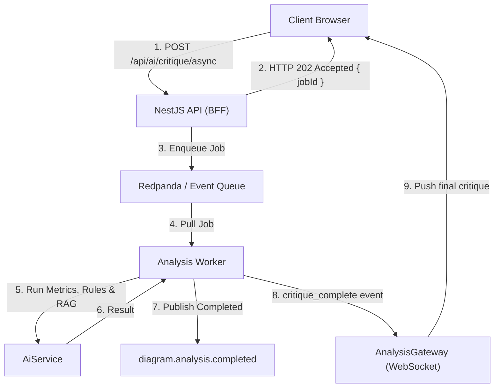

# Stage 5: Asynchronous Queue Architecture & Worker Execution

> **Milestone**: Decouple heavy analysis workloads using Kafka-compatible Redpanda queues, background workers, and real-time WebSocket job notifications.

---

### 1. What did we do?

In Phase 5, we moved long-running architectural evaluations and critiques from synchronous HTTP request-response cycles into an **asynchronous event-driven architecture**:

1. **Redpanda Message Broker & Producer**:
   - Integrated `kafkajs` connecting to Redpanda (`localhost:19092`).
   - Defined topics:
     - `diagram.analysis.requested`: Jobs awaiting worker processing.
     - `diagram.analysis.completed`: Results ready for broadcasting.
   - Built an automatic zero-crash in-memory queue fallback that activates whenever Redpanda/Docker is offline, ensuring 100% test reliability and seamless local development.

2. **Background Analysis Worker**:
   - Implemented `AnalysisWorker` running within NestJS, which subscribes to `diagram.analysis.requested`.
   - Executes the multi-stage evaluation pipeline (`Metrics` $\to$ `Rules` $\to$ `RAG` $\to$ `LLM Synthesis`).
   - Updates `JobStoreService` lifecycle states (`QUEUED` $\to$ `PROCESSING` $\to$ `COMPLETED` / `FAILED`).
   - Emits `critique_complete` payload over WebSockets directly to the subscribed client.

3. **Asynchronous APIs & Polling Support**:
   - `POST /api/ai/critique/async`: Returns `202 Accepted` immediately with `{ jobId, status: "QUEUED" }`.
   - `GET /api/ai/jobs/:jobId`: Query endpoint allowing clients or load tests to poll job status without requiring WebSockets.

4. **Automated Load Testing Suite**:
   - Created pure Node.js `autocannon` benchmark (`server/test/load/autocannon-benchmark.js`) simulating 100 concurrent connections.
   - Authored `k6` test scenarios (`k6-crud-benchmark.js` and `k6-analysis-queue.js`) targeting 100 concurrent Virtual Users (VUs).

---

### 2. Why did we do it?

1. **Eliminate HTTP 504 Gateway Timeouts**:
   - Comprehensive AI critiques and RAG vector searches can take 2–5 seconds. Under high traffic, synchronous HTTP requests exhaust connection pools and trigger browser timeouts.

2. **Protect Against Load Spikes**:
   - A message queue acts as an elastic shock absorber. If 500 users submit architectures simultaneously, the queue buffers requests and workers process them steadily without overwhelming the LLM or database.

3. **Adhere to the Architectural Non-Negotiables**:
   - Rule 6 in `AGENTS.md` states: *"If an operation takes $\ge 1\text{s}$ or does not require an immediate synchronous UI response, route it through the Redpanda message broker; otherwise keep it synchronous."*

---

### 3. What changed?

#### Files Created or Modified:
- **`server/src/queue/`**:
  - `queue.interface.ts`: Standard job payload and lifecycle status types.
  - `job-store.service.ts`: In-memory & Redis-backed job state tracking with TTL.
  - `redpanda-producer.service.ts`: Kafka producer with automatic in-memory queue fallback.
  - `analysis.worker.ts`: Background worker processing jobs and dispatching results.
  - `queue.module.ts`: Global module bundling queue services.
  - `redpanda.service.spec.ts`: Unit tests verifying queue operations and fallback behavior.
- **`server/src/ai/`**:
  - `ai.controller.ts`: Added `POST /api/ai/critique/async` and `GET /api/ai/jobs/:jobId`.
  - `dto/critique.dto.ts`: Added optional `async` boolean flag.
- **`server/src/gateway/analysis.gateway.ts`**:
  - Added `emitCritiqueComplete(...)` method.
- **`client/`**:
  - `src/services/api.ts`: Added `enqueueCritiqueAsync(...)` and `getJobStatus(...)`.
  - `src/services/socket.ts`: Added `subscribeToCritiqueComplete(...)`.
  - `src/components/critique/CritiqueModal.tsx`: Added `QUEUED` step, Redpanda queue badge, and WebSocket completion listener.
  - `src/App.tsx`: Added async critique execution support.
- **Load Testing**:
  - `server/test/load/autocannon-benchmark.js`: 100 concurrent connections benchmark.
  - `server/test/load/k6-crud-benchmark.js`: 100 VUs CRUD scenario.
  - `server/test/load/k6-analysis-queue.js`: Queue load test.

---

### 4. What's next?

In **Phase 6: Live Interview Mode (Milestone v0.8)**, we will build the interactive AI Interviewer:
- Interactive system design challenges ("Design WhatsApp", "Design Netflix").
- Adaptive architectural follow-ups based on candidate diagram edits.
- Objective grading against a fixed 6-category rubric:
  - Availability (25%)
  - Scalability (25%)
  - Reliability (20%)
  - Performance (15%)
  - Security (10%)
  - Cost Awareness (5%)
